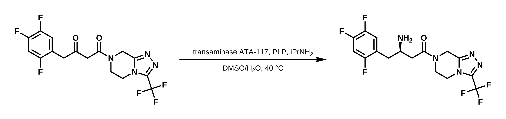

# HexSketch

**Chemists think in structures. LLMs think in text. HexSketch lets chemists
talk to LLMs with structures.**

HexSketch puts a real structure editor inside your chat with Claude. You draw,
Claude sees the drawing. Claude answers by drawing back: structures, reaction
schemes with reagents and conditions, highlighted groups and notes, all in the
same editor you're both working in.

<p align="center">
  
</p>
<p align="center"><sub>The enzymatic step in Merck's sitagliptin (Januvia) process, drawn by HexSketch.
Both compounds are drawn the same way round, and the new stereocentre has its wedge.</sub></p>

## Add it to Claude

Takes a minute. Nothing to install, no account.

1. In Claude, open **Settings › Connectors › Add custom connector**.
2. Name: `HexSketch` · URL: `https://mcp.hexsketch.com/mcp` · click **Add**.
3. Start a new chat and type: *Open HexSketch with ibuprofen*.

Works on claude.ai and in the Claude desktop app. On a Team or Enterprise
plan, an owner adds the connector first.

**Claude Code:** run
`claude mcp add --transport http hexsketch https://mcp.hexsketch.com/mcp`.
For the best drawings, also add the
[HexSketch skill](skills/hexsketch/SKILL.md): copy the `skills/hexsketch`
folder to `~/.claude/skills/`.

**Keep everything on your computer:** download
[hexsketch.mcpb](https://github.com/angus-e-mcmillan/HexSketch/releases/latest/download/hexsketch.mcpb),
double-click it and click **Install** in Claude Desktop. It works offline.
Use either this or the connector, not both.

## Add it to Codex

OpenAI's Codex uses the same connector. Codex in a terminal can't show the
editor, so it draws a picture of each structure or reaction scheme and gives
you a link that opens it in HexSketch, in your browser, to edit by drawing.

1. If you don't have Codex yet, install it and sign in (the first run opens
   your browser):
   ```sh
   npm install -g @openai/codex
   codex
   ```
2. Add HexSketch:
   ```sh
   codex mcp add hexsketch --url https://mcp.hexsketch.com/mcp
   ```
3. For the best drawings, add the HexSketch skill, which teaches Codex how
   chemists draw (reactions as schemes, reagents above the arrow, checking
   its own SMILES):
   ```sh
   mkdir -p ~/.codex/skills/hexsketch/agents
   curl -fsSL https://raw.githubusercontent.com/angus-e-mcmillan/HexSketch/main/skills/hexsketch/SKILL.md -o ~/.codex/skills/hexsketch/SKILL.md
   curl -fsSL https://raw.githubusercontent.com/angus-e-mcmillan/HexSketch/main/skills/hexsketch/agents/openai.yaml -o ~/.codex/skills/hexsketch/agents/openai.yaml
   ```
4. Start `codex` and ask: *Draw the synthesis of aspirin from salicylic acid*.
   Open the link to edit the drawing.

The same setting works in the Codex IDE extension. To check it's connected,
run `codex mcp list`.

To save drawings as files in your project (PNG, SVG, PDF, CDXML for ChemDraw,
MOL), run HexSketch on your computer instead of the connector (needs
Node.js): `codex mcp add hexsketch -- npx -y hexsketch mcp`, then ask, for
example, *save it as aspirin.png*.

## Things to ask

- *Draw the mechanism of tert-butyl ester hydrolysis with acid using curley arrows.*
- *Draw a molecule and ask it, what is the pKa of this compound?*
- *Using HexSketch, draw me a retrosynthesis of AZD7594*
- *Draw a molecule and ask it to analyze the functional groups*

## What Claude can do with it

- **Share one drawing.** Claude sees what you draw as you draw it. Press
  **Full screen** to keep the editor open beside the chat. **Send to chat**
  posts your drawing as a message.
- **Answer in structures.** Claude draws in the editor, highlights parts of a
  molecule in colour, pins short labels to atoms ("pKa ≈ 4.4") and leaves
  notes beside it. Undo brings your drawing back.
- **Walk through mechanisms.** Claude draws each step with curly arrows, and
  you step through them with Back and Next, the atoms staying put from one
  step to the next.
- **Draw proper schemes.** Arrows, "+" signs, reagents above the arrow and
  conditions below, with each compound drawn the same way round as the one
  before.
- **Get the chemistry right.** Offline IUPAC naming, formula, exact mass and
  molecular weight, and a check of every SMILES before it's shown.
- **Hand over the result.** Export PNG, SVG, PDF, CDXML or MOL, or open the
  drawing on [hexsketch.com](https://hexsketch.com) to keep editing.

## Privacy

The connector stores only the editors open in your chats, and deletes each one
a day after it was last used. It has no accounts and doesn't log what you
draw. The desktop extension sends nothing anywhere. Details:
[hexsketch.com/privacy](https://hexsketch.com/privacy).

## The editor on its own

[hexsketch.com](https://hexsketch.com) is a free structure editor in your
browser:

- shortcuts that work like the drawing tools you know;
- copy into Word, PowerPoint or Google Docs and paste back to edit (the
  structure travels inside the picture);
- names, formula and masses under each structure;
- opens and saves CDXML and MOL;
- **safety warnings**: a warning in the status bar when a drawing has an
  energetic group (azide, nitro, diazo, peroxide…, judged by (C + O)/N, the
  rule of six and oxygen balance), a highly toxic or pyrophoric compound, or
  a hazardous reagent written above an arrow. The AI tools report the same,
  so the model tells you. Screening rules, not a safety assessment;
- **Ask AI**: a chat beside the editor with any model on
  [OpenRouter](https://openrouter.ai) (Claude, GPT, Gemini, open models), on
  your own OpenRouter account. It sees what you draw and answers by drawing,
  with the same tools as the Claude connector.

What you draw stays in your browser, unless you send it to Ask AI.

---

## For developers

Scripts, the command line and other AI tools (Codex, Cursor and any MCP
client): see [packages/hexsketch](packages/hexsketch/README.md).
[hexsketch.com/llms.txt](https://hexsketch.com/llms.txt) describes HexSketch
for AI assistants, and [skills/hexsketch](skills/hexsketch/SKILL.md) is the
same guidance the server gives, as a Claude skill.

Building it needs Node 22.

```sh
npm install
npm run dev          # the editor at http://localhost:5174
npm test
npm run typecheck
npm run build:web    # static build in apps/web/dist
npm run build:pkg    # npm package in packages/hexsketch/dist
npm run dev:mcp      # the connector at http://127.0.0.1:8787/mcp
```

`tools/opsin/fetch.sh` downloads OPSIN (needs Java) so the naming tests can
check generated names by parsing them back. Without it those tests are skipped.

```
packages/core      molecule model, SMILES, MOL, CDXML, formula and mass, payload
packages/render    depiction to SVG and PDF
packages/editor    tools, hotkeys, undo
packages/naming    offline IUPAC naming
packages/agent     for AI agents and scripts: render, name, analyze, convert, validate, compare, link, schemes
packages/hexsketch the npm package, `hexsketch` command and local MCP server (docs/releasing.md);
                   src/toolkit.ts is what the AI's tools are, apart from MCP (instructions,
                   tool inputs, showing things in the editor), for every way an AI reaches HexSketch
apps/web           hexsketch.com, plus worker.ts for the feedback endpoint; src/ai.ts is the AI's
                   side of an editor (Notes, highlights, labels, steps), shared with apps/mcp-app
apps/mcp-app       the editor as it appears inside the chat
apps/mcp-worker    the Claude connector at mcp.hexsketch.com (docs/connector.md)
```

### Deployment

Both sites are Cloudflare Workers, deployed by hand.

```sh
npx wrangler login
npm run deploy:web   # hexsketch.com
npm run deploy:mcp   # mcp.hexsketch.com (docs/connector.md)
npm run feedback     # print feedback sent from the editor
```

## Licence

Business Source License 1.1 (`LICENSE`): free to use, at work too, directly or
through AI assistants. You need a commercial licence to distribute or host
HexSketch as part of a product or service for others. Each version becomes
Apache-2.0 four years after its release. The link and picture-payload format
(`docs/link-format.md`) and the code that implements it are MIT (`LICENSE-MIT`).
