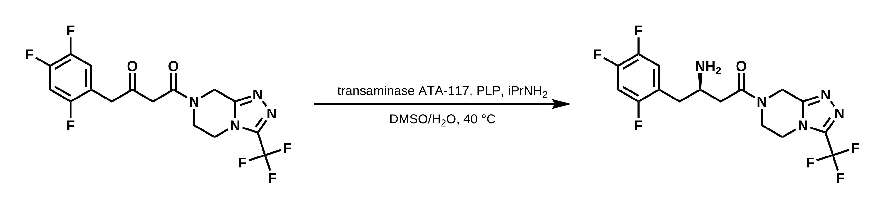

# HexSketch

**Chemists think in sketches. LLMs think in text. HexSketch lets chemists
talk to LLMs with structures.**

HexSketch puts a real structure editor inside your chat with Claude. You draw,
Claude sees the drawing. Claude answers by drawing back: structures, reaction
schemes with reagents and conditions, highlighted groups and notes, all in the
same editor you're both working in.

<p align="center">
  
</p>
<p align="center"><sub>The enzymatic step in Merck's sitagliptin (Januvia) process, drawn by HexSketch.
Both compounds are drawn the same way round, and the new stereocentre has its wedge.</sub></p>

## Add it to Claude

Takes a minute. Nothing to install, no account.

1. In Claude, open **Settings › Connectors › Add custom connector**.
2. Name: `HexSketch` · URL: `https://mcp.hexsketch.com/mcp` · click **Add**.
3. Start a new chat and type: *Open HexSketch with ibuprofen*.

Works on claude.ai and in the Claude desktop app. On a Team or Enterprise
plan, an owner adds the connector first.

**Claude Code:** run
`claude mcp add --transport http hexsketch https://mcp.hexsketch.com/mcp`

**Keep everything on your computer:** download
[hexsketch.mcpb](https://github.com/angus-e-mcmillan/HexSketch/releases/latest/download/hexsketch.mcpb),
double-click it and click **Install** in Claude Desktop. It works offline.
Use either this or the connector, not both.

## Things to ask

- *Draw the synthesis of paracetamol from 4-aminophenol.*
- *Show me the mechanism of ester hydrolysis, step by step.*
- *What is this?* (after drawing something)
- *Highlight the stereocentres in this structure.*
- *Suggest a protecting group for the amine and show the scheme.*
- *Is this SMILES right? CC(=O)Oc1ccccc1C(=O)O*

## What Claude can do with it

- **Share one drawing.** Claude sees what you draw as you draw it. Press
  **Full screen** to keep the editor open beside the chat. **Send to chat**
  posts your drawing as a message.
- **Answer in structures.** Claude draws in the editor, highlights parts of a
  molecule in colour, pins short labels to atoms ("pKa ≈ 4.4") and leaves
  notes beside it. Undo brings your drawing back.
- **Walk through mechanisms.** Claude draws each step with curly arrows, and
  you step through them with Back and Next, the atoms staying put from one
  step to the next.
- **Draw proper schemes.** Arrows, "+" signs, reagents above the arrow and
  conditions below, with each compound drawn the same way round as the one
  before.
- **Get the chemistry right.** Offline IUPAC naming, formula, exact mass and
  molecular weight, and a check of every SMILES before it's shown.
- **Hand over the result.** Export PNG, SVG, PDF, CDXML or MOL, or open the
  drawing on [hexsketch.com](https://hexsketch.com) to keep editing.

## Privacy

The connector stores only the editors open in your chats, and deletes each one
a day after it was last used. It has no accounts and doesn't log what you
draw. The desktop extension sends nothing anywhere. Details:
[hexsketch.com/privacy](https://hexsketch.com/privacy).

## The editor on its own

[hexsketch.com](https://hexsketch.com) is a free structure editor in your
browser:

- shortcuts that work like the drawing tools you know;
- copy into Word, PowerPoint or Google Docs and paste back to edit (the
  structure travels inside the picture);
- names, formula and masses under each structure;
- opens and saves CDXML and MOL.

What you draw stays in your browser.

---

## For developers

Scripts, the command line and other AI tools (Codex, Cursor and any MCP
client): see [packages/hexsketch](packages/hexsketch/README.md).
[hexsketch.com/llms.txt](https://hexsketch.com/llms.txt) describes HexSketch
for AI assistants, and [skills/hexsketch](skills/hexsketch/SKILL.md) is the
same guidance the server gives, as a Claude skill.

Building it needs Node 22.

```sh
npm install
npm run dev          # the editor at http://localhost:5174
npm test
npm run typecheck
npm run build:web    # static build in apps/web/dist
npm run build:pkg    # npm package in packages/hexsketch/dist
npm run dev:mcp      # the connector at http://127.0.0.1:8787/mcp
```

`tools/opsin/fetch.sh` downloads OPSIN (needs Java) so the naming tests can
check generated names by parsing them back. Without it those tests are skipped.

```
packages/core      molecule model, SMILES, MOL, CDXML, formula and mass, payload
packages/render    depiction to SVG and PDF
packages/editor    tools, hotkeys, undo
packages/naming    offline IUPAC naming
packages/agent     for AI agents and scripts: render, name, analyze, convert, validate, compare, link, schemes
packages/hexsketch the npm package, `hexsketch` command and local MCP server (docs/releasing.md)
apps/web           hexsketch.com, plus worker.ts for the feedback endpoint
apps/mcp-app       the editor as it appears inside the chat
apps/mcp-worker    the Claude connector at mcp.hexsketch.com (docs/connector.md)
```

### Deployment

Both sites are Cloudflare Workers, deployed by hand.

```sh
npx wrangler login
npm run deploy:web   # hexsketch.com
npm run deploy:mcp   # mcp.hexsketch.com (docs/connector.md)
npm run feedback     # print feedback sent from the editor
```

## Licence

Business Source License 1.1 (`LICENSE`): free to use, at work too, directly or
through AI assistants. You need a commercial licence to distribute or host
HexSketch as part of a product or service for others. Each version becomes
Apache-2.0 four years after its release. The link and picture-payload format
(`docs/link-format.md`) and the code that implements it are MIT (`LICENSE-MIT`).
